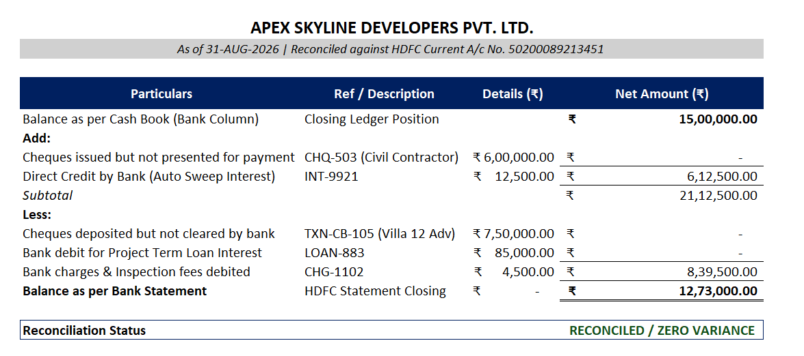

# Bank Reconciliation Model (MS Excel)

An automated financial reconciliation model built in **Microsoft Excel** to match internal cash book records against official bank statements, detect timing discrepancies, and verify balance accuracy.

---

## 📊 Reconciliation Summary Preview

---

## 📌 Project Overview
* **Objective:** Ensure accurate cash balances, resolve ledger differences, and prevent accounting discrepancies.
* **Core Tool:** Microsoft Excel (Advanced Lookup & Audit Formulas).
* **Key Tasks:** Transaction matching, unpresented cheque identification, bank charge verification, and BRS generation.

---

## 🛠️ Implementation Details

### 1. Data Structuring & Hygiene
* Standardized transaction logs for both Cash Book and Bank Statement (`Date`, `Description`, `Ref/Cheque No`, `Debit`, `Credit`).
* Cleaned formatting and ensured consistent numeric and date types.

### 2. Formula Logic & Discrepancy Matching
* **Automated Matching:** Used `XLOOKUP` / `VLOOKUP` to cross-verify transaction references and identify unrecorded items.
* **Conditional Audit:** Applied conditional formatting to flag unmatched rows and missing entries instantly.
* **Balance Verification:** Used `SUMIFS` to summarize total debits and credits across both sources.

### 3. Bank Reconciliation Statement (BRS)
* Prepared a structured reconciliation schedule:
  * Balance as per Cash Book
  * **Add:** Cheques issued but not yet presented / Direct customer deposits
  * **Less:** Cheques deposited but not cleared / Direct bank charges & fees
  * **Equals:** Adjusted balance matching the Bank Statement exactly.

---

## 📁 Repository Contents
* `Bank_Reconciliation_Analysis.xlsx` – Complete Excel workbook with raw data and reconciliation schedules.
* `brs_preview.png` – Visual snapshot of the final BRS statement.
